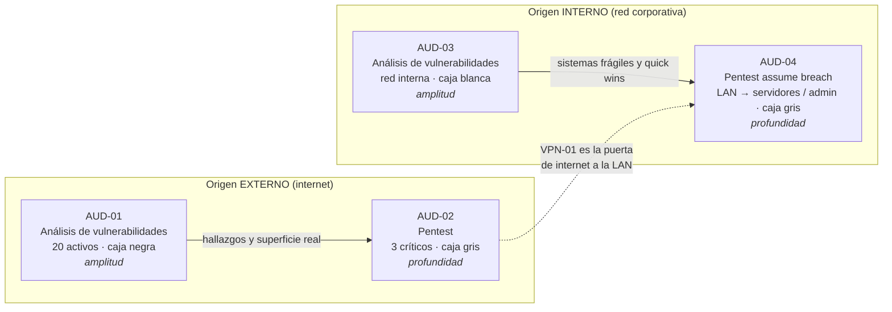

# Apartado 1 · Diseño del plan de auditoría

[⬅ Volver al índice](README.md) · [Apartado 2 ➡](apartado2-fases-calendario.md)

---

## 0. Punto de partida

### 0.1 Premisas del caso (enunciado)

| Premisa | Implicación para el plan |
|---|---|
| Es la **primera vez** que la organización se audita y lo hará una **empresa externa** | No existe línea base de seguridad ni inventario validado por terceros. Hay que empezar por **amplitud** (ver todo) antes que por sofisticación (Red Team). El proveedor no conoce el entorno: el pre-engagement será más largo y conviene darle información donde ocultarla no aporte valor. |
| Presupuesto: **máximo 5 auditorías** en el trimestre | Cada auditoría debe aportar algo que no aporte otra. Se evita solapar enfoques sobre los mismos activos salvo en los críticos. |
| **20 activos expuestos** a internet (web, correo, VPN) | Superficie de ataque externa amplia y heterogénea → necesita una revisión de cobertura total. |
| **3 activos críticos** para el negocio | Merecen **profundidad** (explotación real, superficie autenticada) y no solo detección. |
| **Primera revisión de la red interna** | Debe haber al menos una auditoría con origen **interno**. Al ser la primera, hay que medir la higiene general *y* lo que podría hacer un atacante que ya está dentro. |

### 0.2 Suposiciones

El enunciado no detalla el reparto de los activos ni el tamaño de la red interna. Para poder estimar alcance y tiempos se fijan estas suposiciones; si los datos reales son otros, la estructura del plan no cambia, solo las cifras.

> **Suposición S1 (reparto de los 20 activos):** 12 servidores web (`WEB-01`…`WEB-12`), 5 servidores de correo (`MAIL-01`…`MAIL-05`: servidor corporativo, MX secundario, pasarela antispam, webmail…) y 3 accesos VPN (`VPN-01`…`VPN-03`).
>
> **Suposición S2 (activos críticos):** los 3 activos críticos son uno de cada tipo: `WEB-01` (aplicación web de negocio con usuarios autenticados y acceso a bases de datos), `MAIL-01` (servidor de correo corporativo) y `VPN-01` (concentrador VPN de acceso remoto de empleados). Es una suposición razonable porque cada uno es un punto único de fallo distinto: negocio, comunicaciones y puerta de entrada a la red interna.
>
> **Suposición S3 (red interna):** existe una LAN de usuarios y segmentos de servidores. El número de hosts se fija en el pre-engagement; para estimar tiempos se supone un entorno de tamaño medio (del orden de 2–3 rangos /24 accesibles desde la LAN de usuarios).
>
> **Suposición S4 (trimestre):** primer trimestre natural, enero–marzo (≈ 13 semanas). Las fechas concretas están en el [apartado 2](apartado2-fases-calendario.md).

| Tipo de activo | Nº total | Críticos | No críticos |
|---|:-:|:-:|:-:|
| Servidores web | 12 | 1 (`WEB-01`) | 11 |
| Servidores de correo | 5 | 1 (`MAIL-01`) | 4 |
| Accesos VPN | 3 | 1 (`VPN-01`) | 2 |
| **Total expuesto** | **20** | **3** | **17** |
| Red interna (LAN usuarios + segmentos de servidores) | S3 | — | — |

### 0.3 Marco de clasificación que se usa

| Criterio | Valores | Qué significa en este plan |
|---|---|---|
| **Enfoque** | Análisis de vulnerabilidades · Test de intrusión (pentest) · Red Team | *Análisis de vulnerabilidades*: amplitud; identifica y valida debilidades sin llegar a explotarlas a fondo. *Pentest*: profundidad; explota, encadena y demuestra el impacto real dentro de un alcance acotado. *Red Team*: simula a un adversario concreto, de forma sigilosa y por objetivos, para medir también la detección y la respuesta. |
| **Origen** | Externa · Interna | Desde dónde se lanzan las pruebas: desde internet, con la visión de cualquier atacante, o desde dentro de la red de la organización. |
| **Información** | Caja negra · Caja gris · Caja blanca | Cuánta información recibe el auditor: solo el alcance autorizado (negra), información parcial como usuarios de prueba o un diagrama de alto nivel (gris), o información completa con documentación, configuraciones y credenciales privilegiadas (blanca). |

---

## Resumen del plan

Se planifican **4 auditorías** y se deja la **5.ª como reserva de contingencia** que solo se gasta si se activa (ver [§ 1.5](#15-por-qué-4-auditorías-y-no-5)).

| ID | Auditoría | Activos | Enfoque | Origen | Información |
|---|---|---|---|---|---|
| **AUD-01** | Análisis de vulnerabilidades del perímetro | Los 20 activos expuestos | Análisis de vulnerabilidades | Externa | Caja negra |
| **AUD-02** | Pentest de activos críticos | 3 críticos (`WEB-01`, `MAIL-01`, `VPN-01`) | Test de intrusión | Externa | Caja gris |
| **AUD-03** | Análisis de vulnerabilidades de la red interna | Rangos internos accesibles desde la LAN (S3) | Análisis de vulnerabilidades | Interna | Caja blanca |
| **AUD-04** | Pentest interno con compromiso supuesto (*assume breach*) | Un puesto de usuario estándar como punto de partida; alcance: red interna, incluida la segmentación | Test de intrusión | Interna | Caja gris |
| *AUD-05* | *Reserva de contingencia (solo si se activa)* | *Según el disparador* | *—* | *—* | *—* |

La lógica del plan es una matriz **amplitud × profundidad** para cada **origen**:

---

## 1.1 Elección de las auditorías

### Por qué esta combinación

1. **Primero amplitud y después profundidad.** En una primera auditoría el mayor riesgo suele estar en lo que no se sabe que existe: servicios olvidados, versiones sin parchear, paneles expuestos. Un análisis de vulnerabilidades da cobertura total con poco coste por activo. El pentest se reserva para donde el impacto justifica pagar profundidad: los críticos y la red interna.
2. **Los dos orígenes están cubiertos.** El enunciado pide expresamente la red interna. Además, muchos incidentes empiezan en un puesto de usuario (phishing, malware), así que auditar solo el perímetro daría una visión incompleta.
3. **Los tres niveles de información se usan donde aportan.** Caja negra donde interesa la visión del atacante anónimo (perímetro), caja gris donde interesa la superficie autenticada o el compromiso supuesto, y caja blanca donde ocultar información solo haría perder horas pagadas (higiene interna).
4. **Se descarta un Red Team.** Mide la detección y la respuesta frente a un adversario sigiloso, pero exige una madurez que la organización aún no ha demostrado: no hay línea base de vulnerabilidades corregidas ni un equipo defensivo evaluado. Además es caro y de alcance estrecho. Tiene sentido en trimestres posteriores, cuando lo básico esté resuelto.
5. **No se audita ingeniería social, wifi ni código fuente.** No forman parte de los activos del enunciado, y con un presupuesto limitado se prioriza lo que se ha pedido.

### Justificación de cada auditoría

| ID | Por qué se elige |
|---|---|
| **AUD-01** | Es la única forma asequible de cubrir **los 20 activos** con el mismo criterio. Da la foto inicial del perímetro, permite contrastar el inventario declarado con lo que realmente se ve desde internet y alimenta al resto de auditorías: si aparece algo grave en un no crítico, se sabrá en la primera semana. Es la base de todo el plan. |
| **AUD-02** | Los 3 críticos son los activos en los que un incidente paraliza el negocio. No basta con saber que *podría* haber una vulnerabilidad: hay que demostrar si un atacante desde internet llega a comprometerlos, encadenando fallos y probando la parte que solo ve un usuario autenticado (lógica de negocio, control de acceso, inyecciones tras el login). Un análisis automático no cubre eso. |
| **AUD-03** | La red interna nunca se ha revisado. Antes de simular un ataque hace falta saber **qué hay** (inventario real, sistemas obsoletos, servicios inseguros como FTP o SMB sin firmar, parches pendientes). Es amplitud, igual que AUD-01, pero desde dentro. |
| **AUD-04** | Responde a la pregunta de dirección: *¿qué pasa si alguien ya está dentro?* (empleado malintencionado, portátil infectado, credenciales robadas por la VPN). Mide la escalada de privilegios, el movimiento lateral y, sobre todo, si la **segmentación** entre la LAN de usuarios y los segmentos sensibles (servidores, administración) se puede saltar. |

---

## 1.2 Activos incluidos en el alcance de cada auditoría

La cobertura se reparte por capas: todos los activos expuestos tienen al menos una revisión y los críticos tienen tres capas (AUD-01, AUD-02 y, por su exposición hacia dentro, AUD-04).

| Activo | AUD-01 | AUD-02 | AUD-03 | AUD-04 |
|---|:-:|:-:|:-:|:-:|
| `WEB-01` (crítico) | ✅ | ✅ | — | ↔ (*backend*/BD internos, si son alcanzables desde la LAN) |
| `MAIL-01` (crítico) | ✅ | ✅ | — | ↔ (interfaz interna) |
| `VPN-01` (crítico) | ✅ | ✅ | — | ↔ (destino de la VPN: a qué segmentos da acceso) |
| 11 web no críticos | ✅ | — | — | — |
| 4 correo no críticos | ✅ | — | — | — |
| 2 VPN no críticas | ✅ | — | — | — |
| Red interna (S3) | — | — | ✅ | ✅ |

### AUD-01 · 20 activos (12 web, 5 correo, 3 VPN)

- **Qué entra:** los 20 activos, identificados por IP y dominio en el documento de alcance, más la superficie que se descubra por OSINT (subdominios, registros DNS, certificados). Los activos nuevos que aparezcan **no se prueban** hasta que el cliente los autorice por escrito.
- **Por qué:** es la única auditoría que mira todo el perímetro. Los críticos también entran, con pruebas no intrusivas y en ventana acordada, por dos motivos: así toda la superficie se mide con la misma vara, y se obtiene la visión de un atacante **sin información** sobre ellos, que complementa la caja gris de AUD-02.

### AUD-02 · 3 activos críticos

- **Qué entra:** `WEB-01` (aplicación completa, incluida la zona autenticada y sus roles), `MAIL-01` (servicios SMTP/IMAP/webmail, retransmisión, suplantación, autenticación) y `VPN-01` (portal y servicio VPN, autenticación, MFA, y qué acceso concede una vez dentro).
- **Por qué:** concentran el impacto de negocio. Limitar el pentest a 3 activos permite dedicar unas 5 jornadas a cada uno (ver el [apartado 2](apartado2-fases-calendario.md)), suficientes para hacer explotación manual en lugar de quedarse en un escaneo. Los 17 no críticos no entran: su riesgo queda medido en AUD-01, y un pentest sobre los 20 diluiría las horas.
- **Excluido explícitamente:** denegación de servicio y cualquier prueba que degrade la disponibilidad en horario de negocio.

### AUD-03 · Red interna

- **Qué entra:** los rangos internos accesibles desde la LAN de usuarios (S3): servidores, servicios de infraestructura (directorio, ficheros, FTP, impresión, bases de datos) y una muestra representativa de puestos de trabajo.
- **Por qué:** es la primera revisión interna y el objetivo es el inventario y la higiene general. Los segmentos que no son alcanzables desde la LAN (por ejemplo, la subred de administración) **no** se escanean aquí: comprobar si se puede llegar a ellos es precisamente el trabajo de AUD-04.
- **Excluido:** sistemas que IT declare frágiles (por ejemplo, OT o equipos médicos o industriales, si los hubiera). Se listan en el pre-engagement.

### AUD-04 · Red interna desde un puesto de usuario

- **Qué entra:** punto de partida en un **puesto de usuario estándar** de la LAN, con una cuenta de dominio sin privilegios. El alcance es la red interna, incluida la **comprobación de la segmentación** hacia subredes restringidas (administración) y hacia los *backends* internos de los activos críticos.
- **Por qué:** reproduce el escenario más probable de intrusión interna. Se evalúa el camino desde *usuario* hasta *joyas de la corona*, no cada host por separado, que ya cubre AUD-03.
- **Excluido:** puestos de directivos y sistemas de terceros (salvo autorización específica), y acciones destructivas o de persistencia real.

---

## 1.3 Tipo de auditoría (enfoque, origen e información)

### AUD-01 · Análisis de vulnerabilidades externo · Caja negra

| Criterio | Elección | Justificación |
|---|---|---|
| **Enfoque** | Análisis de vulnerabilidades | Prima la **amplitud**: 20 activos heterogéneos en una primera auditoría. Combina escaneo automatizado con validación manual de falsos positivos, sin explotación profunda. Un pentest sobre los 20 consumiría el presupuesto de varias auditorías. |
| **Origen** | Externa | Los 20 activos están expuestos a internet y el riesgo que se quiere medir es el de **cualquier atacante de internet**. Las pruebas se lanzan desde la infraestructura del proveedor, con IPs de origen declaradas para poder distinguirlas en los registros. |
| **Información** | Caja negra | Solo se entrega lo imprescindible para autorizar legalmente las pruebas: el alcance (IPs y dominios). Así se mide qué descubre un atacante sin información y se detectan discrepancias con el inventario. Dar más información aquí no ahorra horas, porque el descubrimiento *es* parte del objetivo. |

### AUD-02 · Pentest externo de activos críticos · Caja gris

| Criterio | Elección | Justificación |
|---|---|---|
| **Enfoque** | Test de intrusión | Prima la **profundidad**: hay que demostrar el impacto real (¿se toma el control del correo?, ¿se llega a la base de datos de negocio?, ¿la VPN da paso a la red interna?) encadenando vulnerabilidades. Es lo que la dirección necesita para priorizar la inversión en los activos críticos. |
| **Origen** | Externa | Los 3 críticos están expuestos y el escenario de mayor probabilidad e impacto es un ataque desde internet. |
| **Información** | Caja gris | Se entregan **usuarios de prueba** de cada rol (aplicación web, buzón, cuenta VPN) y documentación funcional de alto nivel, pero no código ni credenciales de administrador. Motivos: (1) gran parte de la superficie de `WEB-01` está tras el login, y en caja negra el auditor podría no llegar a verla en el tiempo contratado; (2) simula un escenario realista, el de unas credenciales robadas por phishing o un cliente malintencionado; (3) la visión en caja negra de estos activos ya la aporta AUD-01. La caja blanca se descarta porque aquí interesa la visión del atacante, no una revisión de configuración. |

### AUD-03 · Análisis de vulnerabilidades interno · Caja blanca

| Criterio | Elección | Justificación |
|---|---|---|
| **Enfoque** | Análisis de vulnerabilidades | Es una **primera revisión** de toda la red interna: se busca cobertura e inventario (parches, servicios inseguros, configuraciones débiles), no explotar cada hallazgo. |
| **Origen** | Interna | El objetivo está en la red interna, que no es accesible desde internet. El auditor trabaja *in situ* o desde un equipo o *appliance* conectado a la LAN; las pruebas se lanzan desde dentro. |
| **Información** | Caja blanca | Se entrega el inventario de rangos, el diagrama de red y credenciales de solo lectura para hacer escaneo **autenticado**. En una revisión de higiene, ocultar información solo hace que el proveedor pierda horas pagadas descubriendo lo que IT ya sabe, y el escaneo autenticado detecta muchas más vulnerabilidades (parches locales, software instalado) que uno sin credenciales. La visión del atacante ya la cubre AUD-04. |

### AUD-04 · Pentest interno (*assume breach*) · Caja gris

| Criterio | Elección | Justificación |
|---|---|---|
| **Enfoque** | Test de intrusión | Interesa la **cadena de ataque**: escalar privilegios, moverse lateralmente y saltar la segmentación. Eso solo lo demuestra un pentest. No se elige Red Team porque no se busca medir el sigilo ni la respuesta del SOC, sino encontrar el máximo de caminos explotables en tiempo limitado, con la colaboración del cliente. |
| **Origen** | Interna | El escenario es un atacante que **ya está dentro** (empleado, malware, credenciales robadas usadas por la VPN). Se parte de un puesto de usuario de la LAN. |
| **Información** | Caja gris | El auditor recibe lo que tendría un empleado normal: un puesto estándar, una cuenta de dominio sin privilegios y un diagrama de alto nivel de los segmentos. No recibe los resultados de AUD-03 ni credenciales privilegiadas, para no falsear el escenario. En caja negra se gastaría tiempo en conseguir un acceso inicial que ya damos por supuesto; en caja blanca ya no sería la visión de un atacante. |

---

## 1.4 Objetivo de cada auditoría

| ID | Objetivo concreto | Cómo sabremos que se ha cumplido |
|---|---|---|
| **AUD-01** | Obtener la **línea base de seguridad del perímetro**: qué ve un atacante desde internet en los 20 activos, qué vulnerabilidades conocidas y configuraciones débiles tienen, y si hay activos expuestos fuera del inventario. | Informe con el 100 % de los activos revisados, hallazgos clasificados con CVSS, discrepancias de inventario y una lista priorizada de correcciones rápidas. |
| **AUD-02** | Determinar si un atacante desde internet, con o sin credenciales de usuario, puede **comprometer alguno de los 3 activos críticos** y con qué impacto para el negocio (confidencialidad del correo, datos de la aplicación, acceso a la red interna). | Para cada activo crítico, conclusión explícita ("comprometido / no comprometido"), cadena de ataque documentada con evidencias, y retest de las correcciones de severidad Crítica o Alta. |
| **AUD-03** | Hacer la **primera foto de la higiene de la red interna**: inventario real, sistemas sin soporte, parches pendientes y servicios inseguros. | Inventario contrastado con el de IT, hallazgos clasificados con CVSS y un plan de remediación por fases que IT pueda asumir. |
| **AUD-04** | Medir **hasta dónde llega un atacante que ya está en la LAN de usuarios**: si puede convertirse en administrador del dominio, alcanzar los *backends* de los activos críticos o **saltar la segmentación** hacia la subred de administración. | Caminos de ataque documentados de *usuario estándar → objetivo*, estado de la segmentación verificado y recomendaciones estructurales (segmentación, mínimo privilegio, bastionado). |

---

## 1.5 Por qué 4 auditorías y no 5

- **Cada auditoría planificada responde a una pregunta distinta** (perímetro amplio, críticos en profundidad, red interna amplia y red interna en profundidad). Una quinta auditoría fija solaparía con alguna de ellas.
- **La capacidad de corrección es limitada.** En una primera auditoría se espera un volumen alto de hallazgos. Un departamento recién creado tiene que coordinar la remediación con sistemas, y saturarlo de informes en el mismo trimestre reduce lo que realmente se corrige.
- **Coordinar con un proveedor externo tiene un coste.** Cada auditoría conlleva pre-engagement, autorizaciones y reuniones. Cuatro auditorías escalonadas ya ocupan el trimestre (ver el [apartado 2](apartado2-fases-calendario.md)).
- **La 5.ª queda como reserva de contingencia (AUD-05)**, no se planifica de antemano. Se activa solo si ocurre alguno de estos disparadores:
  - AUD-01 revela un no crítico con exposición grave (por ejemplo, RCE) que necesita explotación confirmada.
  - Se publica una vulnerabilidad crítica que afecta a `MAIL-01` o `VPN-01` durante el trimestre.
  - Un hallazgo de AUD-02 o AUD-04 exige un retest que no cabe en su fase de cierre.

  Ventana prevista: semanas 10–12. Si no se activa, se ahorra presupuesto.

---

## Tabla resumen final

| Auditoría | Enfoque | Origen | Información | Activos | Objetivo |
|---|---|---|---|---|---|
| **AUD-01** · Perímetro | Análisis de vulnerabilidades | Externa | Caja negra | 20 expuestos (12 web, 5 correo, 3 VPN) | Línea base del perímetro, vulnerabilidades conocidas y discrepancias de inventario. |
| **AUD-02** · Críticos | Test de intrusión | Externa | Caja gris (usuarios de prueba) | 3 críticos: `WEB-01`, `MAIL-01`, `VPN-01` | Demostrar si se pueden comprometer los críticos desde internet y con qué impacto. |
| **AUD-03** · Red interna | Análisis de vulnerabilidades | Interna | Caja blanca (inventario, diagrama, credenciales de escaneo) | Rangos internos accesibles desde la LAN (S3) | Primera foto de la higiene interna e inventario real. |
| **AUD-04** · *Assume breach* | Test de intrusión | Interna | Caja gris (puesto y usuario estándar) | Red interna desde un puesto de la LAN, incluida la segmentación hacia administración | Medir escalada, movimiento lateral y salto de segmentación. |
| *AUD-05* · *Reserva* | *Según el disparador* | *—* | *—* | *—* | *Contingencia; solo se gasta si se activa.* |

---

[⬅ Volver al índice](README.md) · [Apartado 2 ➡](apartado2-fases-calendario.md)
