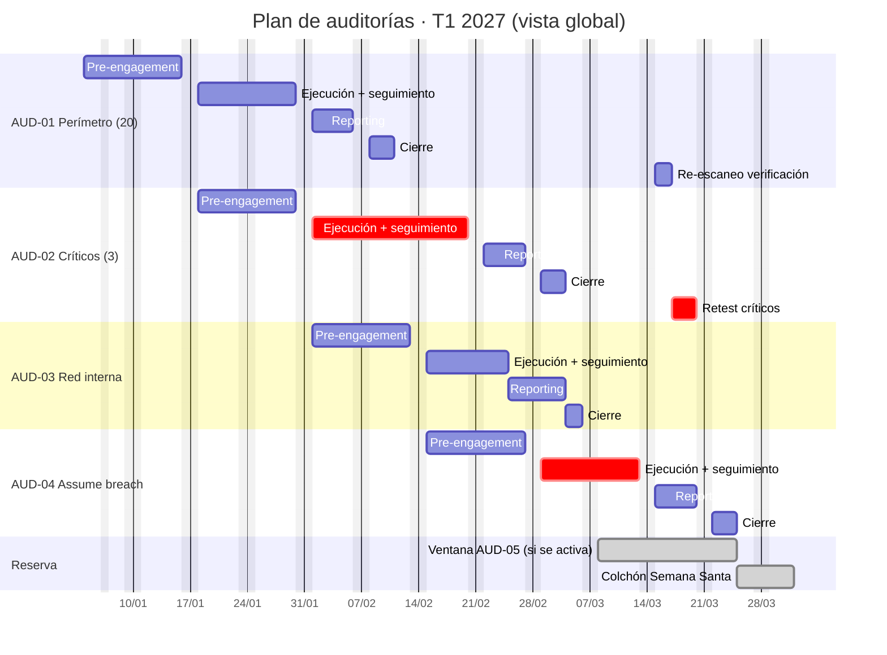
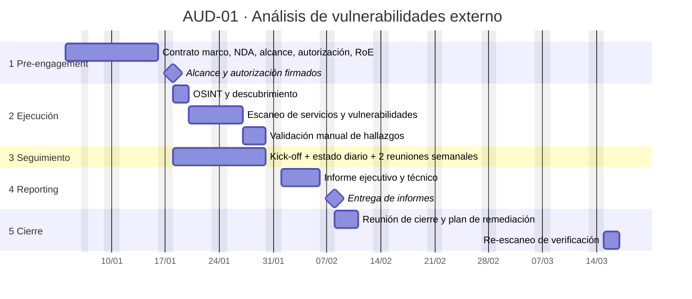
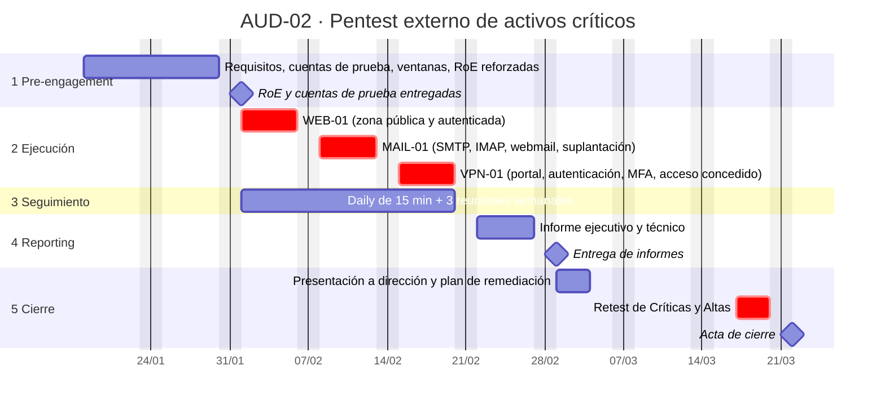
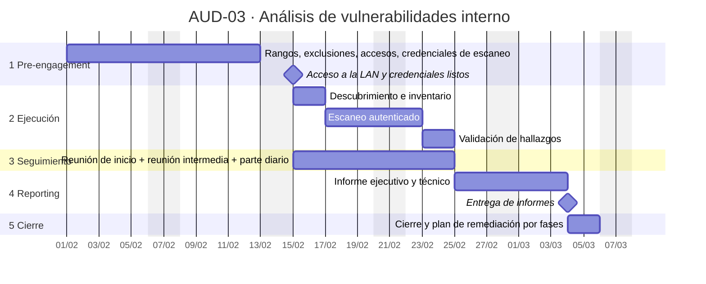
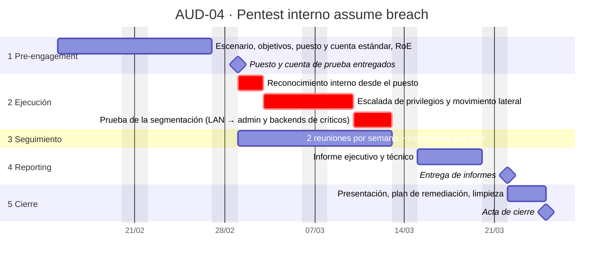

# Apartado 2 · Fases y calendario de las auditorías

[⬅ Apartado 1](apartado1-plan-auditoria.md) · [Índice](README.md) · [Apartado 3 ➡](apartado3-vulnerabilidades-cvss.md)

---

## 2.0 Criterios comunes

### Las 5 fases y cómo encajan

| Fase | Qué es | Cómo se planifica |
|---|---|---|
| 1. Pre-engagement | Toma de requisitos, alcance, autorización legal y reglas de enganche (*Rules of Engagement*, RoE) | Antes de empezar cualquier prueba. Ninguna prueba sin autorización firmada. |
| 2. Ejecución | Pruebas técnicas | Bloque de jornadas consecutivas. |
| 3. Seguimiento | Control del avance, comunicación de incidencias y de hallazgos críticos | **En paralelo a la ejecución**: no es una fase posterior, sino el canal de control mientras se prueba. |
| 4. Reporting | Redacción, revisión de calidad y entrega de informes | Al terminar la ejecución. |
| 5. Cierre | Presentación de resultados, plan de remediación, retest, devolución de accesos y borrado de datos | Tras el informe; el retest se programa después de dar tiempo a corregir. |

### Criterio de estimación de tiempos

> **Suposición:** las duraciones son estimaciones en **jornadas hábiles de auditor** (las jornadas que una persona dedica a pruebas o informes), basadas en ratios habituales del sector y ajustadas a este caso; no son datos del enunciado.

| Auditoría | Ratio de ejecución | Cálculo | Ejecución | Reporting |
|---|---|---|:-:|:-:|
| AUD-01 · Análisis de vulnerabilidades externo | ≈ 0,5 jornadas/activo (escaneo y validación manual, sin explotación) | 20 activos × 0,5 | **10 j** | 5 j |
| AUD-02 · Pentest externo de críticos | ≈ 5 jornadas/activo crítico (explotación manual, superficie autenticada y encadenamiento) | 3 activos × 5 | **15 j** | 5 j |
| AUD-03 · Análisis de vulnerabilidades interno | Escaneo autenticado de 2–3 rangos /24 (S3) y validación | 2 j de descubrimiento + 4 j de escaneo + 2 j de validación | **8 j** | 5 j |
| AUD-04 · Pentest interno *assume breach* | *Time-box* (tiempo cerrado): se prueban caminos de ataque, no hosts | 2 j de reconocimiento + 5 j de escalada y movimiento lateral + 3 j de segmentación | **10 j** | 5 j |

- **Pre-engagement:** 9–10 jornadas. AUD-01 es la primera y carga con el **marco contractual** con el proveedor (contrato marco, acuerdo de confidencialidad o NDA, seguro de responsabilidad, avisos a los proveedores de alojamiento o *hosting* e ISP). Las demás lo reutilizan, pero necesitan preparar cuentas de prueba o accesos internos.
- **Reporting:** unas 5 jornadas en todas, porque incluye informe ejecutivo, informe técnico y una revisión de calidad interna del proveedor.
- **Cierre:** 2–3 jornadas, más un **retest** separado para los críticos (2–3 jornadas) una vez que ha pasado tiempo para corregir.

### Reparto en el trimestre

- **Escalonado:** cada pre-engagement se hace mientras se ejecuta la auditoría anterior. Así el trimestre se aprovecha y no se acumulan dos ejecuciones sobre el mismo entorno a la vez.
- **Orden:** el perímetro va antes que los críticos, para que AUD-02 parta de lo visto en AUD-01, y la higiene interna va antes que el *assume breach*, para que IT conozca los sistemas frágiles antes de que se ataquen.
- **Calendario:** enero–marzo de 2027. Se excluyen fines de semana y el 6 de enero, y se deja **libre la Semana Santa (25–31 de marzo)** como colchón.

> **Suposición:** solo se consideran festivos nacionales; habría que ajustar los autonómicos o locales (por ejemplo, el 19 de marzo en algunas comunidades).

### Vista global del trimestre

---

## AUD-01 · Análisis de vulnerabilidades externo (20 activos · caja negra)

### 2.1 Calendario

| Fase | Inicio | Fin | Jornadas | Comentario |
|---|---|---|:-:|---|
| 1. Pre-engagement | 04/01 | 15/01 | 9 | Más larga por ser la primera: incluye el marco contractual común. |
| 2. Ejecución | 18/01 | 29/01 | 10 | 20 activos × 0,5 j. |
| 3. Seguimiento | 18/01 | 29/01 | En paralelo | Ver [§ 2.3](#23-reuniones-de-seguimiento). |
| 4. Reporting | 01/02 | 05/02 | 5 | |
| 5. Cierre | 08/02 | 10/02 | 3 | Más un re-escaneo de verificación el 15–16/03 (2 j). |

### 2.2 Hitos y objetivos de cada fases

| Fase | Objetivos | Hitos / entregables |
|---|---|---|
| **1. Pre-engagement** | Dejar el marco legal y operativo cerrado antes de tocar un solo sistema. | ✔ Contrato marco y **NDA** firmados con el proveedor · ✔ **Documento de alcance** con las 20 IPs y dominios · ✔ **Autorización legal** firmada por un responsable con poder (dirección) y aviso a los proveedores de *hosting* o ISP · ✔ **RoE**: ventanas horarias, intensidad máxima de escaneo, prohibición de DoS, IPs de origen del auditor, qué hacer con activos fuera de alcance · ✔ Matriz de contactos y **procedimiento de escalado** (incluida la parada de emergencia) · ✔ Reunión de arranque (*kick-off*). |
| **2. Ejecución** | Cubrir el 100 % de los activos y validar los hallazgos. | ✔ Mapa de superficie expuesta (puertos, servicios, versiones, subdominios) · ✔ Lista de discrepancias con el inventario · ✔ Hallazgos validados manualmente (sin falsos positivos) · ✔ Evidencias registradas. |
| **3. Seguimiento** | Controlar el avance y reaccionar a tiempo. | ✔ Parte de estado diario (activos revisados / pendientes) · ✔ Actas de las reuniones semanales · ✔ **Comunicación inmediata** de cualquier hallazgo crítico (≤ 24 h), sin esperar al informe. |
| **4. Reporting** | Traducir los hallazgos en decisiones. | ✔ **Informe ejecutivo** (riesgo global, top 5 de riesgos, recomendaciones para dirección) · ✔ **Informe técnico** (cada hallazgo con CVSS, evidencias, pasos de reproducción y remediación) · ✔ Lista de *quick wins*. |
| **5. Cierre** | Transferir el conocimiento y verificar las correcciones. | ✔ Reunión de presentación de resultados · ✔ **Plan de remediación** con responsables y fechas · ✔ Devolución o revocación de accesos y certificado de **borrado de datos** por el proveedor · ✔ **Re-escaneo** de verificación de los hallazgos Críticos y Altos · ✔ Acta de cierre firmada. |

### 2.3 Reuniones de seguimiento

**Sí se contemplan: una reunión semanal (2 en total) y un parte de estado diario por correo.**

- Es la **primera auditoría con un proveedor nuevo**: el equipo de Juan necesita comprobar pronto que el proveedor respeta las RoE (ventanas, intensidad) y aprender cómo trabaja.
- Al ser un análisis no intrusivo de 2 semanas, el riesgo operativo es bajo, así que una reunión diaria sería excesiva. El parte diario basta para controlar el avance.
- Si aparece algo crítico, se convoca una reunión **extraordinaria** en menos de 24 h, aparte del calendario semanal.

---

## AUD-02 · Pentest externo de activos críticos (3 activos · caja gris)

### 2.1 Calendario

| Fase | Inicio | Fin | Jornadas | Comentario |
|---|---|---|:-:|---|
| 1. Pre-engagement | 18/01 | 29/01 | 10 | En paralelo a la ejecución de AUD-01. Requiere preparar cuentas de prueba y coordinarse con los responsables de negocio. |
| 2. Ejecución | 01/02 | 19/02 | 15 | 5 j por activo crítico. Empieza cuando ya se tienen los resultados de AUD-01. |
| 3. Seguimiento | 01/02 | 19/02 | En paralelo | Ver [§ 2.3](#23-reuniones-de-seguimiento-1). |
| 4. Reporting | 22/02 | 26/02 | 5 | |
| 5. Cierre | 01/03 | 03/03 | 3 | Retest el 17–19/03, tras unas 2 semanas para corregir. |

### 2.2 Hitos y objetivos de cada fase

| Fase | Objetivos | Hitos / entregables |
|---|---|---|
| **1. Pre-engagement** | Proteger la operación de los activos críticos y darle al auditor lo que necesita para la caja gris. | ✔ **Alcance firmado** (los 3 activos, URLs, funcionalidades y roles incluidos) · ✔ **Autorización legal** específica para la explotación · ✔ **RoE reforzadas**: horarios de menor actividad, prohibición de DoS y de modificar o borrar datos reales, límites al volumen de datos que se pueden exfiltrar como prueba (solo evidencias mínimas), qué hacer si se compromete un sistema · ✔ **Cuentas de prueba** por rol (web, buzón, VPN) y datos de prueba · ✔ Contactos 24×7 de los responsables de cada activo y procedimiento de **parada de emergencia** · ✔ Copias de seguridad verificadas antes de empezar. |
| **2. Ejecución** | Demostrar el impacto real sobre cada crítico. | ✔ Por cada activo, conclusión "comprometido / no comprometido" · ✔ Cadenas de ataque documentadas con evidencias · ✔ Superficie autenticada probada por rol (control de acceso, inyecciones, lógica de negocio). |
| **3. Seguimiento** | Detectar a tiempo cualquier impacto en producción y comunicar los hallazgos críticos. | ✔ Actas de las reuniones diarias (*daily*) y semanales · ✔ **Notificación inmediata** de hallazgos de severidad Crítica (como la [V1](apartado3-vulnerabilidades-cvss.md#v1--sistema-de-correo-control-total-del-servidor)) para mitigarlos en el momento · ✔ Registro de incidencias. |
| **4. Reporting** | Dar a dirección una base para decidir la inversión en los críticos. | ✔ **Informe ejecutivo** por activo crítico (riesgo para el negocio) · ✔ **Informe técnico** con vector CVSS, evidencias, reproducción y remediación · ✔ Narrativa de las cadenas de ataque. |
| **5. Cierre** | Comprobar que las correcciones son eficaces y cerrar formalmente. | ✔ Presentación a dirección · ✔ Plan de remediación aprobado · ✔ **Retest** de los hallazgos Críticos y Altos con informe de retest · ✔ **Revocación** de las cuentas de prueba y certificado de borrado de evidencias sensibles · ✔ Acta de cierre. |

### 2.3 Reuniones de seguimiento

**Sí se contemplan: *daily* de 15 minutos y una reunión semanal formal (3 en total).**

- Son los **3 activos críticos** y se van a **explotar** de verdad: cualquier efecto no deseado (caída de servicio, bloqueo de cuentas, alertas) tiene que detectarse y corregirse el mismo día. Esa es la razón de la reunión diaria.
- La reunión semanal coincide con el cambio de activo (`WEB-01` → `MAIL-01` → `VPN-01`). Sirve para revisar lo encontrado y ajustar las prioridades del siguiente bloque.
- Los hallazgos críticos no esperan a ninguna reunión: se comunican **inmediatamente**, por el canal de escalado acordado en las RoE.

---

## AUD-03 · Análisis de vulnerabilidades interno (red interna · caja blanca)

### 2.1 Calendario

| Fase | Inicio | Fin | Jornadas | Comentario |
|---|---|---|:-:|---|
| 1. Pre-engagement | 01/02 | 12/02 | 10 | En paralelo a la ejecución de AUD-02. |
| 2. Ejecución | 15/02 | 24/02 | 8 | Termina antes de que empiece AUD-04. |
| 3. Seguimiento | 15/02 | 24/02 | En paralelo | |
| 4. Reporting | 25/02 | 03/03 | 5 | |
| 5. Cierre | 04/03 | 05/03 | 2 | El retest de lo interno se hará en el siguiente trimestre (ver más abajo). |

### 2.2 Hitos y objetivos de cada fase

| Fase | Objetivos | Hitos / entregables |
|---|---|---|
| **1. Pre-engagement** | Preparar el acceso interno sin poner en riesgo la operación. | ✔ **Alcance firmado** con los rangos internos y la **lista de exclusiones** (sistemas frágiles) · ✔ **Autorización** firmada por dirección y conocimiento del responsable de sistemas · ✔ **RoE**: horario, intensidad del escaneo, prohibición de explotar, tratamiento de datos personales encontrados · ✔ Punto de red o *appliance* en la LAN y **credenciales de solo lectura** para el escaneo autenticado · ✔ Inventario y diagrama de red entregados (caja blanca). |
| **2. Ejecución** | Obtener la foto real de la red interna. | ✔ Inventario descubierto frente al declarado · ✔ Hallazgos de higiene (parches, sistemas sin soporte, servicios inseguros como FTP o SMBv1) · ✔ Hallazgos validados. |
| **3. Seguimiento** | Evitar que el escaneo afecte a los usuarios. | ✔ Parte diario · ✔ Acta de la reunión intermedia · ✔ Notificación de hallazgos críticos en ≤ 24 h. |
| **4. Reporting** | Priorizar la remediación interna. | ✔ **Informe ejecutivo** y **técnico** (CVSS, evidencias, remediación) · ✔ Hallazgos agrupados por causa raíz (por ejemplo, la gestión de parches). |
| **5. Cierre** | Dejar un plan que IT pueda asumir. | ✔ Reunión de cierre · ✔ **Plan de remediación por fases** (30/60/90 días) · ✔ Revocación de credenciales, retirada del *appliance* y certificado de borrado · ✔ Acta de cierre · ✔ Retest planificado para el siguiente trimestre. |

> El retest no se hace en este trimestre porque los hallazgos internos de higiene (por ejemplo, actualizar sistemas sin soporte) suelen necesitar ciclos de cambio de más de 2–3 semanas. Hacerlo antes de que estén corregidos sería gastar presupuesto.

### 2.3 Reuniones de seguimiento

**Sí se contemplan, de forma ligera: una reunión de arranque, una intermedia (a mitad de la ejecución, 19/02) y un parte diario por correo.**

- La ejecución dura poco (8 jornadas) y es **no intrusiva**, con la colaboración de IT (caja blanca). Una reunión semanal coincidiría prácticamente con el inicio y el final, así que basta con una revisión intermedia.
- Lo que sí se vigila a diario es el **impacto del escaneo** en la LAN (bloqueos de cuentas, saturación de enlaces). Para eso basta con el parte diario y un canal directo con el responsable de sistemas.

---

## AUD-04 · Pentest interno *assume breach* (caja gris)

### 2.1 Calendario

| Fase | Inicio | Fin | Jornadas | Comentario |
|---|---|---|:-:|---|
| 1. Pre-engagement | 15/02 | 26/02 | 10 | En paralelo a la ejecución de AUD-03. |
| 2. Ejecución | 01/03 | 12/03 | 10 | *Time-box*. Empieza cuando AUD-03 ha terminado sus pruebas. |
| 3. Seguimiento | 01/03 | 12/03 | En paralelo | Ver [§ 2.3](#23-reuniones-de-seguimiento-3). |
| 4. Reporting | 15/03 | 19/03 | 5 | |
| 5. Cierre | 22/03 | 24/03 | 3 | Acaba antes de Semana Santa. El retest va al siguiente trimestre, salvo que se active AUD-05. |

### 2.2 Hitos y objetivos de cada fase

| Fase | Objetivos | Hitos / entregables |
|---|---|---|
| **1. Pre-engagement** | Definir el escenario y los límites de una prueba que va a explotar sistemas internos. | ✔ **Alcance y escenario firmados** (punto de partida, objetivos o "trofeos": administrador de dominio, subred de administración, *backends* de los críticos) · ✔ **Autorización legal** específica para la explotación interna · ✔ **RoE**: prohibición de acciones destructivas, de persistencia real y de acceder a datos personales más allá de la evidencia mínima; qué hacer con las credenciales obtenidas; limpieza obligatoria · ✔ Puesto estándar y **cuenta de dominio sin privilegios** · ✔ Aviso controlado al equipo de sistemas o SOC (no se mide la detección) · ✔ Procedimiento de **parada de emergencia**. |
| **2. Ejecución** | Encontrar caminos de ataque de *usuario estándar → objetivo*. | ✔ Caminos de ataque documentados paso a paso · ✔ Estado de la **segmentación** verificado · ✔ Registro de todas las acciones del auditor, con hora, para poder correlacionarlas. |
| **3. Seguimiento** | Controlar el riesgo de las pruebas intrusivas en producción. | ✔ Actas de las reuniones · ✔ Comunicación inmediata de hallazgos críticos (como la [V3](apartado3-vulnerabilidades-cvss.md#v3--rce-en-servidor-ftp-interno-con-privilegios-de-sistema)) y de cualquier incidencia · ✔ Validación con el cliente antes de usar credenciales privilegiadas obtenidas. |
| **4. Reporting** | Explicar el riesgo interno como cadenas, no como listas. | ✔ **Informe ejecutivo** ("en X horas un usuario estándar llega a…") · ✔ **Informe técnico** con CVSS, cadenas de ataque y recomendaciones estructurales (segmentación, mínimo privilegio, bastionado de servicios). |
| **5. Cierre** | Dejar el entorno limpio y el plan aprobado. | ✔ Presentación a dirección · ✔ Plan de remediación · ✔ **Limpieza verificada** (cuentas, ficheros o herramientas dejadas por el auditor) · ✔ Cambio de las credenciales comprometidas durante la prueba · ✔ Certificado de borrado · ✔ Acta de cierre. |

### 2.3 Reuniones de seguimiento

**Sí se contemplan: 2 reuniones por semana (lunes y jueves, 4 en total) y un cierre diario por chat.**

- Es la prueba **más intrusiva del plan** sobre la red de producción (explotación, uso de credenciales, movimiento lateral). Hace falta poder parar o reconducir rápidamente.
- Varias acciones requieren **validación previa** del cliente (por ejemplo, usar una credencial de administrador obtenida o entrar en la subred de administración). Las reuniones frecuentes evitan bloqueos.
- No es diaria con reunión formal porque el cierre diario por chat ya cubre el control día a día: cada tarde, el auditor resume qué ha hecho y qué hará al día siguiente.

---

## Resumen de reuniones de seguimiento

| Auditoría | ¿Reuniones? | Periodicidad | Motivo principal |
|---|:-:|---|---|
| AUD-01 | Sí | Semanal (2) + parte diario por correo | Proveedor nuevo y pruebas no intrusivas: control ligero. |
| AUD-02 | Sí | *Daily* de 15 min + semanal (3) | Explotación de activos críticos: hay que detectar el impacto el mismo día. |
| AUD-03 | Sí, ligeras | Reunión de arranque + 1 intermedia + parte diario | Ejecución corta, no intrusiva y con IT colaborando. |
| AUD-04 | Sí | 2 por semana + cierre diario por chat | Prueba intrusiva en producción que necesita validaciones del cliente. |
| Todas | — | **Comunicación inmediata** de hallazgos críticos | No se espera al informe para mitigar un riesgo crítico. |

---

[⬅ Apartado 1](apartado1-plan-auditoria.md) · [Índice](README.md) · [Apartado 3 ➡](apartado3-vulnerabilidades-cvss.md)
