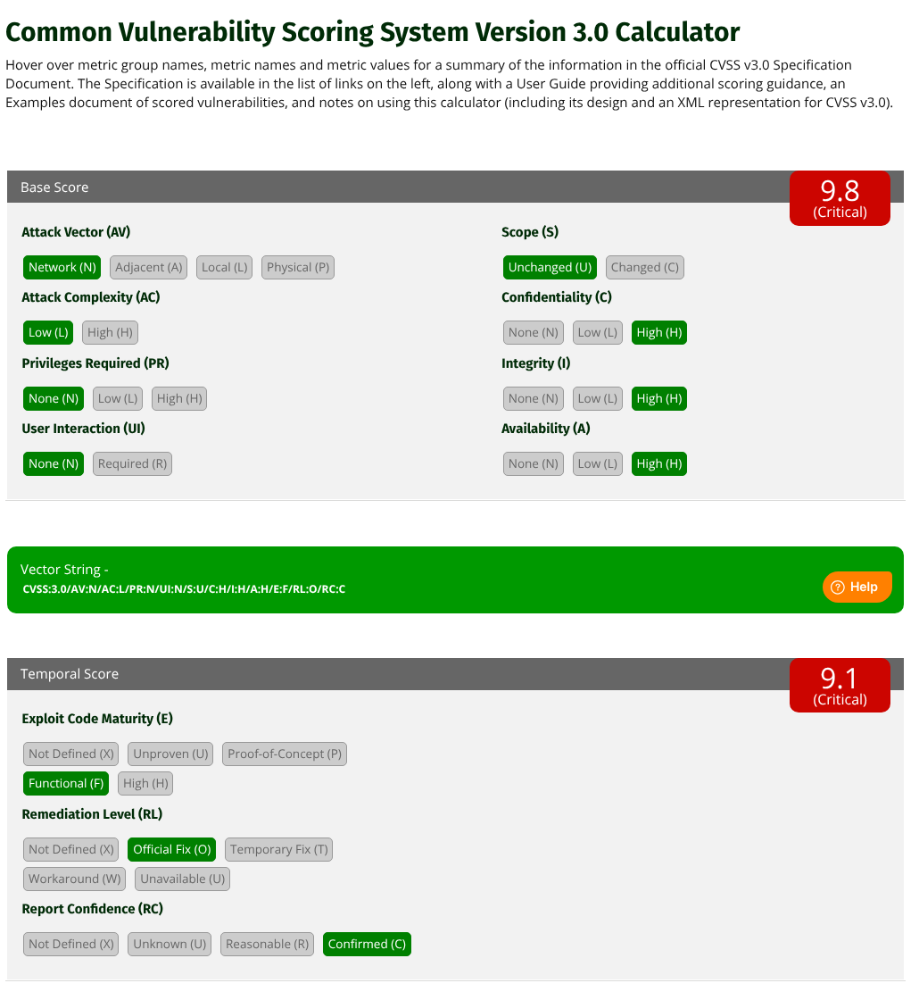
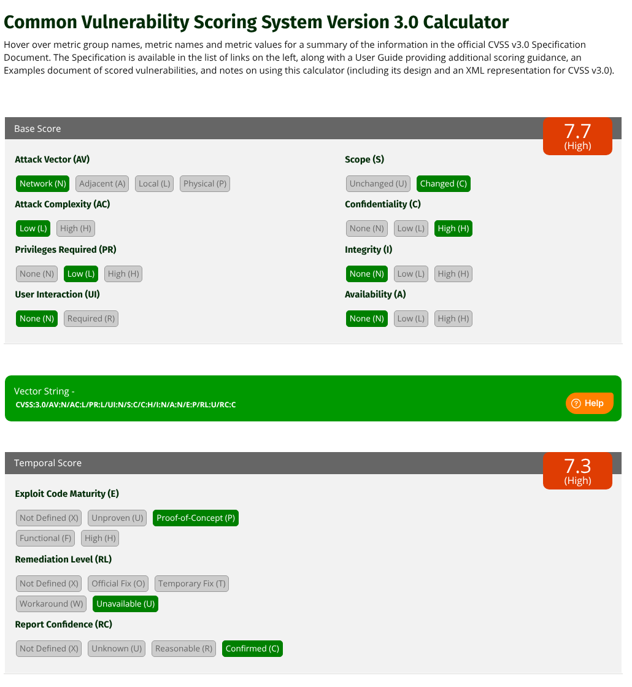
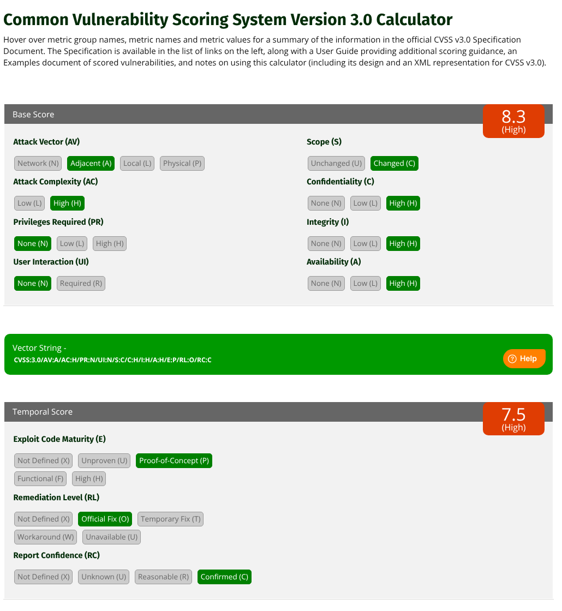

# Apartado 3 · Presentación y valoración de vulnerabilidades (CVSS v3.0)

[⬅ Apartado 2](apartado2-fases-calendario.md) · [Índice](README.md)

---

## 3.0 Método

- Se usa **CVSS v3.0** con las **fórmulas oficiales** de la [especificación de FIRST](https://www.first.org/cvss/v3.0/specification-document). Los resultados se han comprobado con la [calculadora oficial](https://www.first.org/cvss/calculator/3.0); las capturas están en cada vulnerabilidad.
- La **puntuación base** es la valoración de la vulnerabilidad en sí, y es la que se pide.
- Se añade la **puntuación temporal** como complemento, porque el enunciado da información que la puntuación base no recoge: si hay exploit público, si hay parche y si la vulnerabilidad está confirmada. Ayuda a priorizar la remediación.

### Recordatorio de las fórmulas (v3.0)

```text
ISS = 1 − (1 − C) × (1 − I) × (1 − A)

Impacto   S:U → 6,42 × ISS
          S:C → 7,52 × (ISS − 0,029) − 3,25 × (ISS − 0,02)^15

Explotab. = 8,22 × AV × AC × PR × UI

Base      S:U → Roundup( min(Impacto + Explotab., 10) )
          S:C → Roundup( min(1,08 × (Impacto + Explotab.), 10) )
          (si Impacto ≤ 0 → 0)

Temporal  = Roundup( Base × E × RL × RC )
```

Pesos usados: AV N=0,85 · A=0,62 · AC L=0,77 · H=0,44 · PR N=0,85 · L=0,62 (S:U) / 0,68 (S:C) · UI N=0,85 · C/I/A H=0,56 · N=0 · E F=0,97 · P=0,94 · RL O=0,95 · U=1 · RC C=1.

Escala cualitativa: Ninguna 0,0 · Baja 0,1–3,9 · Media 4,0–6,9 · Alta 7,0–8,9 · Crítica 9,0–10,0.

---

## V1 · Sistema de correo: control total del servidor

> *Vulnerabilidad en el sistema de correo que permite tomar el control del servidor, acceder a los mensajes de cualquier usuario y enviar correos suplantando su identidad. El servidor está expuesto en internet. Existe un exploit público en exploit-db y un parche del fabricante.*

### 3.1 Vector y puntuación

| | Vector | Puntuación | Severidad |
|---|---|:-:|:-:|
| **Base** | `CVSS:3.0/AV:N/AC:L/PR:N/UI:N/S:U/C:H/I:H/A:H` | **9.8** | **Crítica** |
| Temporal (complemento) | `…/E:F/RL:O/RC:C` | 9.1 | Crítica |

**Cálculo:**
- ISS = 1 − 0,44³ = 0,9148
- Impacto (S:U) = 6,42 × 0,9148 = **5,8731**
- Explotabilidad = 8,22 × 0,85 × 0,77 × 0,85 × 0,85 = **3,8870**
- Base = Roundup(5,8731 + 3,8870) = Roundup(9,7601) = **9,8**
- Temporal = Roundup(9,8 × 0,97 × 0,95 × 1) = Roundup(9,0307) = **9,1**

✔ Comprobación: vector, cálculo manual y calculadora coinciden (9,8 / 9,1).

### 3.2 Justificación de cada métrica

| Métrica | Valor | Por qué este valor y no otro |
|---|---|---|
| **AV** · Vector de ataque | **N** (Red) | El servidor de correo **está expuesto en internet**: cualquiera puede atacarlo de forma remota, a través de varios saltos de red. No es A (no hace falta estar en la misma red local), ni L (no hace falta acceso local o sesión en el equipo), ni P (no hace falta tocarlo físicamente). |
| **AC** · Complejidad | **L** (Baja) | Existe un **exploit público** en exploit-db: el ataque se puede repetir sin depender de condiciones que el atacante no controle (no hay que ganar ninguna condición de carrera ni conocer secretos del entorno). El enunciado no menciona ninguna configuración especial necesaria. No hay motivo para H. |
| **PR** · Privilegios | **N** (Ninguno) | El enunciado dice que la vulnerabilidad permite *tomar el control* del servidor y acceder al correo de *cualquier* usuario, sin mencionar que haga falta una cuenta. En V2, en cambio, sí se dice expresamente. Por tanto, el atacante no necesita autenticarse. Si hiciera falta un buzón válido sería L. |
| **UI** · Interacción del usuario | **N** (Ninguna) | El ataque va **directo contra el servidor**. Ningún usuario tiene que abrir un correo, pulsar un enlace o hacer nada. |
| **S** · Alcance | **U** (Sin cambio) | El componente vulnerable es el servidor de correo, y lo que se ve afectado (buzones, envío de correo, el propio sistema) está bajo su **misma autoridad de seguridad**: leer buzones y enviar como cualquier usuario es justo lo que controla ese servidor. No se dice que el ataque permita comprometer otro sistema con su propia autoridad. La suplantación ante terceros es una consecuencia del abuso del propio servicio, no la ruptura de un límite de seguridad hacia otro componente. |
| **C** · Confidencialidad | **H** (Alta) | Acceso a los **mensajes de cualquier usuario**: pérdida total de confidencialidad de toda la información que gestiona el componente. |
| **I** · Integridad | **H** (Alta) | **Tomar el control** del servidor permite modificar cualquier dato, y además se pueden **enviar correos suplantando** a los usuarios. La integridad de la información y de la identidad de los remitentes queda totalmente comprometida. |
| **A** · Disponibilidad | **H** (Alta) | Con el control del servidor, el atacante puede pararlo, borrar buzones o dejar el servicio de correo inutilizable para todos los usuarios. |
| *E* · Madurez del exploit | *F* (Funcional) | Hay un exploit **público y funcional** en exploit-db. No es H porque no se dice que esté automatizado o integrado en herramientas de ataque masivo (gusanos, *frameworks*). |
| *RL* · Nivel de remediación | *O* (Oficial) | Existe un **parche del fabricante**. |
| *RC* · Confianza en el informe | *C* (Confirmada) | Vulnerabilidad conocida, con exploit y parche del fabricante, y verificada por el auditor durante las pruebas. |

### 3.3 ¿Afecta al servidor o a los clientes?

**Afecta al servidor.**
- El fallo está en el **software del servidor de correo** y se explota atacando directamente ese servidor desde internet, sin que intervenga ningún cliente (UI:N).
- Los clientes de correo (Outlook, webmail en el navegador, móviles) no son vulnerables ni hay que actualizarlos.
- Las **consecuencias recaen sobre los usuarios**: sus correos quedan expuestos y su identidad se puede suplantar ante terceros, incluidos los destinatarios externos. Esto aumenta el impacto, pero no cambia dónde está la vulnerabilidad ni dónde hay que corregirla, que es el servidor (aplicar el parche del fabricante).

### 3.4 Captura de la calculadora



---

## V2 · Inyección SQL en servidor web con acceso a otras bases de datos

> *Inyección SQL que permite consultar datos de otras bases de datos, como la de Contabilidad. El servidor web está expuesto en internet, pero hace falta un usuario para acceder a la funcionalidad vulnerable. No es una vulnerabilidad conocida: la encontró el auditor durante la auditoría.*

### 3.1 Vector y puntuación

| | Vector | Puntuación | Severidad |
|---|---|:-:|:-:|
| **Base** | `CVSS:3.0/AV:N/AC:L/PR:L/UI:N/S:C/C:H/I:N/A:N` | **7.7** | **Alta** |
| Temporal (complemento) | `…/E:P/RL:U/RC:C` | 7.3 | Alta |

**Cálculo:**
- ISS = 1 − (1 − 0,56) × 1 × 1 = 0,56
- Impacto (S:C) = 7,52 × (0,56 − 0,029) − 3,25 × (0,54)^15 = 3,9931 − 0,0003 = **3,9928**
- Explotabilidad = 8,22 × 0,85 × 0,77 × **0,68** × 0,85 = **3,1096** (con S:C, PR:L pesa 0,68)
- Base = Roundup(1,08 × (3,9928 + 3,1096)) = Roundup(7,6706) = **7,7**
- Temporal = Roundup(7,7 × 0,94 × 1 × 1) = Roundup(7,238) = **7,3**

✔ Comprobación: vector, cálculo manual y calculadora coinciden (7,7 / 7,3).

### 3.2 Justificación de cada métrica

| Métrica | Valor | Por qué este valor y no otro |
|---|---|---|
| **AV** · Vector de ataque | **N** (Red) | El servidor web está **expuesto en internet** y la inyección se envía en peticiones HTTP normales desde cualquier lugar. |
| **AC** · Complejidad | **L** (Baja) | Una vez autenticado, basta con enviar la carga de inyección al parámetro vulnerable. No depende de condiciones que el atacante no controle, y el auditor pudo explotarla. |
| **PR** · Privilegios | **L** (Bajos) | ⚠ **Clave:** el enunciado dice que *hace falta un usuario* para llegar a la funcionalidad vulnerable. **No es N**, porque un atacante anónimo no la alcanza. **No es H**, porque no se dice que haga falta un usuario administrador o con permisos especiales: basta con una cuenta normal de la aplicación, que se puede registrar, comprar o robar por phishing. |
| **UI** · Interacción del usuario | **N** (Ninguna) | El propio atacante, con su cuenta, envía la petición maliciosa. No depende de que **otro** usuario haga nada. Usar la cuenta propia ya se ha contado en PR, no en UI. |
| **S** · Alcance | **C** (Cambiado) | ⚠ **Clave:** el **componente vulnerable** es la aplicación web, cuya autoridad de seguridad son *sus* datos. El **componente afectado** son **otras bases de datos**, como la de Contabilidad, que pertenecen a otro sistema de información con otros propietarios, usuarios y controles de acceso. La vulnerabilidad permite **salir del ámbito de autorización** de la aplicación y afectar a recursos gestionados por otra autoridad. Por eso hay cambio de alcance. Si la inyección solo diera acceso a la base de datos propia de la aplicación, el alcance sería U y la puntuación bajaría a 6,5. |
| **C** · Confidencialidad | **H** (Alta) | Se pueden **consultar** bases de datos ajenas, entre ellas la de **Contabilidad**: información financiera muy sensible. El atacante puede leer cualquier dato de esas bases, así que hay pérdida total de confidencialidad en el componente afectado. |
| **I** · Integridad | **N** (Ninguna) | El enunciado solo habla de **consultar** datos. No se dice que se puedan modificar, y no se inventa ese impacto. Si el auditor demostrara escritura (por ejemplo, con consultas apiladas, *stacked queries*), I subiría a L o H. |
| **A** · Disponibilidad | **N** (Ninguna) | No se describe ningún impacto en la disponibilidad del servicio ni de las bases de datos. |
| *E* · Madurez del exploit | *P* (Prueba de concepto) | No es una vulnerabilidad conocida y **no existe código público**. Solo la ha demostrado el auditor. No es U porque se ha demostrado en la práctica, ni F porque no circula un exploit funcional disponible para cualquiera. |
| *RL* · Nivel de remediación | *U* (No disponible) | Es una vulnerabilidad **nueva**, encontrada durante la auditoría: no hay parche ni solución publicada. |
| *RC* · Confianza en el informe | *C* (Confirmada) | El auditor la ha **reproducido y explotado**, así que existe con certeza. |

### 3.3 ¿Afecta al servidor o a los clientes?

**Afecta al servidor.**
- La inyección SQL es un fallo de la **aplicación del lado del servidor**, que construye consultas SQL con datos sin validar, y se ejecuta en el **servidor de bases de datos**.
- Los navegadores de los usuarios no ejecutan nada malicioso. A diferencia de, por ejemplo, un XSS, que sí afecta a los clientes, aquí el atacante usa su propio cliente solo como medio para enviar la carga.
- Los datos expuestos pueden ser de terceros (por ejemplo, clientes o proveedores que aparezcan en Contabilidad), pero eso es el impacto. La corrección es en el servidor: consultas parametrizadas, validación de entradas y un usuario de base de datos con mínimo privilegio, sin acceso a otras bases.

### 3.4 Captura de la calculadora



---

## V3 · RCE en servidor FTP interno con privilegios de sistema

> *Ejecución remota de código en un servidor FTP de la red interna. El servicio se ejecutaba con privilegios del sistema. El acceso al servidor permite llegar a una subred de administración que no es accesible desde la LAN de usuarios. Existe un parche público. No hay exploit público, pero sí una prueba de concepto que el auditor ha tenido que modificar para poder explotar la vulnerabilidad correctamente.*

### 3.1 Vector y puntuación

| | Vector | Puntuación | Severidad |
|---|---|:-:|:-:|
| **Base** | `CVSS:3.0/AV:A/AC:H/PR:N/UI:N/S:C/C:H/I:H/A:H` | **8.3** | **Alta** |
| Temporal (complemento) | `…/E:P/RL:O/RC:C` | 7.5 | Alta |

**Cálculo:**
- ISS = 1 − 0,44³ = 0,9148
- Impacto (S:C) = 7,52 × (0,9148 − 0,029) − 3,25 × (0,8948)^15 = 6,6613 − 0,6136 = **6,0477**
- Explotabilidad = 8,22 × **0,62** × **0,44** × 0,85 × 0,85 = **1,6201**
- Base = Roundup(1,08 × (6,0477 + 1,6201)) = Roundup(8,2813) = **8,3**
- Temporal = Roundup(8,3 × 0,94 × 0,95 × 1) = Roundup(7,4119) = **7,5**

✔ Comprobación: vector, cálculo manual y calculadora coinciden (8,3 / 7,5).

### 3.2 Justificación de cada métrica

| Métrica | Valor | Por qué este valor y no otro |
|---|---|---|
| **AV** · Vector de ataque | **A** (Red adyacente) | El servidor FTP está **en la red interna** y no es accesible desde internet: para atacarlo hay que estar conectado a la red de la organización. El ataque es por red (no es L ni P), pero el conjunto de atacantes posibles está limitado a quien tiene acceso a esa red, y no es cualquiera en internet (no es N). **Suposición:** el FTP está en la red local a la que se conecta el atacante, sin enrutamiento desde fuera. *Nota:* si el FTP fuera alcanzable a través de routers desde otras redes, la especificación v3.0 (que define A como "no atraviesa un límite de capa 3") llevaría a AV:N, y la base subiría a 9,0. |
| **AC** · Complejidad | **H** (Alta) | ⚠ **Clave:** la PoC existente **no funcionaba tal cual**: el auditor tuvo que **modificarla** para explotar la vulnerabilidad en este objetivo. Eso indica que el éxito depende de **condiciones del entorno** que el atacante no controla y que tiene que investigar y adaptar (versión o compilación concreta, configuración, direcciones de memoria…). La especificación v3.0 incluye en AC:H precisamente que el atacante tenga que *"recopilar conocimiento sobre el entorno del objetivo"* o *"preparar el ataque para mejorar la fiabilidad del exploit"*. No es L, porque el ataque no se puede repetir de forma fiable sin ese trabajo previo. La falta de un exploit público se refleja además, por separado, en la métrica temporal E:P. Con AC:L la base sería 9,6. |
| **PR** · Privilegios | **N** (Ninguno) | El enunciado no menciona que haga falta una cuenta FTP ni ningún otro tipo de autenticación. Se entiende que la RCE se produce antes de autenticarse. **Suposición:** si hiciera falta un usuario FTP, sería L (base 8,0). |
| **UI** · Interacción del usuario | **N** (Ninguna) | El atacante envía la petición al servicio FTP. Ningún usuario tiene que hacer nada. |
| **S** · Alcance | **C** (Cambiado) | ⚠ **Clave:** el componente vulnerable es el servidor FTP. Al comprometerlo, el atacante llega a una **subred de administración que no es accesible desde la LAN de usuarios**: esa subred está protegida por **otra autoridad de seguridad** (la segmentación de red y sus controles de acceso). La vulnerabilidad permite **saltar un límite de seguridad** y afectar a recursos fuera del ámbito del componente vulnerable. Si el impacto se limitara al propio servidor, el alcance sería U (base 7,5). |
| **C** · Confidencialidad | **H** (Alta) | El servicio se ejecuta con **privilegios del sistema**: el atacante puede leer cualquier fichero del servidor, incluidas credenciales, y desde ahí alcanzar la subred de administración. |
| **I** · Integridad | **H** (Alta) | Con privilegios del sistema *"puede realizar cualquier acción"*: modificar ficheros, instalar software y crear usuarios. |
| **A** · Disponibilidad | **H** (Alta) | Puede detener servicios, borrar datos o apagar el servidor. Pérdida total de disponibilidad. |
| *E* · Madurez del exploit | *P* (Prueba de concepto) | No hay exploit público, solo una **PoC** que hubo que adaptar. No es F, porque no hay un exploit funcional que funcione en la mayoría de situaciones, ni U, porque la explotación está demostrada. |
| *RL* · Nivel de remediación | *O* (Oficial) | Existe un **parche público**. |
| *RC* · Confianza en el informe | *C* (Confirmada) | El auditor la ha **explotado con éxito**. |

### 3.3 ¿Afecta al servidor o a los clientes?

**Afecta al servidor.**
- La vulnerabilidad está en el **servicio FTP del servidor** y se explota enviándole peticiones directamente. Los clientes FTP de los usuarios no intervienen ni son vulnerables.
- La gravedad la aumentan dos factores, ambos del lado del servidor: que el servicio se ejecute con **privilegios del sistema** (incumple el principio de mínimo privilegio) y que el servidor tenga **acceso a la subred de administración** (una segmentación defectuosa). La remediación es en el servidor: aplicar el parche, ejecutar el servicio con una cuenta sin privilegios (o sustituir FTP por SFTP) y revisar las reglas que le dan acceso a la red de administración.

### 3.4 Captura de la calculadora



---

## Análisis de sensibilidad (métricas discutibles)

Estas son las métricas que admiten más de una lectura, el valor elegido y cómo cambiaría la puntuación base con la alternativa:

| Vulnerabilidad | Métrica | Elegido | Alternativa | Base elegida → alternativa |
|---|---|---|---|:-:|
| V2 | S | C (otras bases de datos) | U | 7,7 → 6,5 |
| V2 | I | N (solo consulta) | L | 7,7 → 8,5 |
| V3 | AV | A (red interna) | N | 8,3 → 9,0 |
| V3 | AC | H (PoC adaptada al entorno) | L | 8,3 → 9,6 |
| V3 | S | C (salto a la subred de administración) | U | 8,3 → 7,5 |
| V3 | PR | N (no se menciona autenticación) | L | 8,3 → 8,0 |

---

## Tabla resumen

| Vulnerabilidad | Vector (base) | Puntuación base | Severidad | Temporal | Afecta a |
|---|---|:-:|:-:|:-:|---|
| **V1** · Correo: control del servidor, lectura y suplantación | `CVSS:3.0/AV:N/AC:L/PR:N/UI:N/S:U/C:H/I:H/A:H` | **9.8** | **Crítica** | 9.1 (`E:F/RL:O/RC:C`) | Servidor (el impacto recae sobre los usuarios) |
| **V2** · SQLi con acceso a la BD de Contabilidad | `CVSS:3.0/AV:N/AC:L/PR:L/UI:N/S:C/C:H/I:N/A:N` | **7.7** | **Alta** | 7.3 (`E:P/RL:U/RC:C`) | Servidor (aplicación web y servidor de bases de datos) |
| **V3** · RCE en FTP interno con privilegios del sistema | `CVSS:3.0/AV:A/AC:H/PR:N/UI:N/S:C/C:H/I:H/A:H` | **8.3** | **Alta** | 7.5 (`E:P/RL:O/RC:C`) | Servidor (servicio FTP) |

**Prioridad de remediación:** V1 (crítica, expuesta a internet y con exploit público: parchear de inmediato), después V3 (salto de segmentación hacia la subred de administración) y V2 (no tiene parche: requiere corregir el código y, mientras tanto, restringir los permisos del usuario de base de datos).

---

[⬅ Apartado 2](apartado2-fases-calendario.md) · [Índice](README.md)
